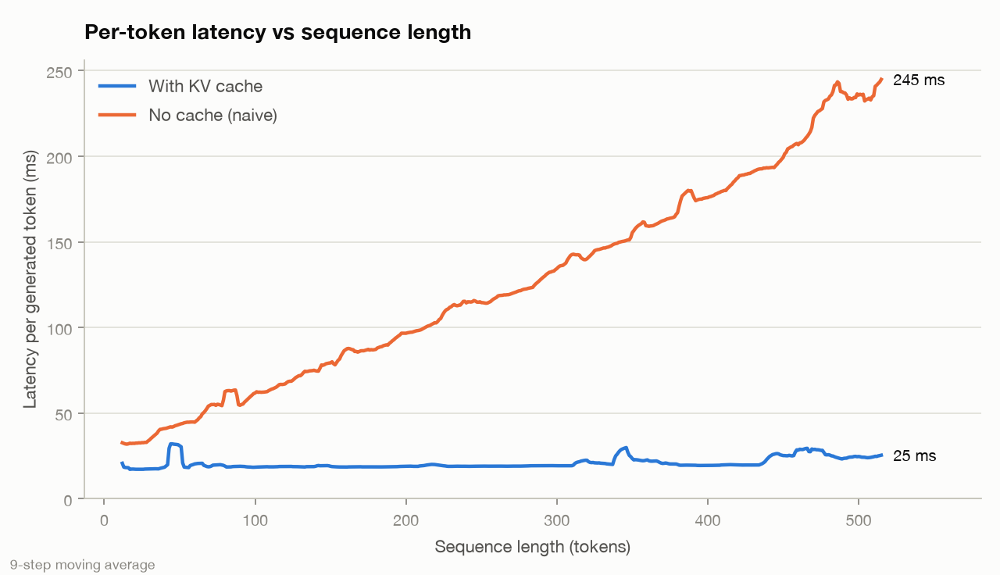
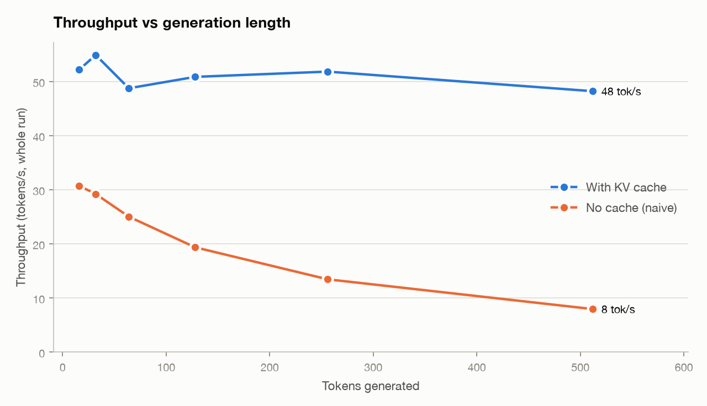
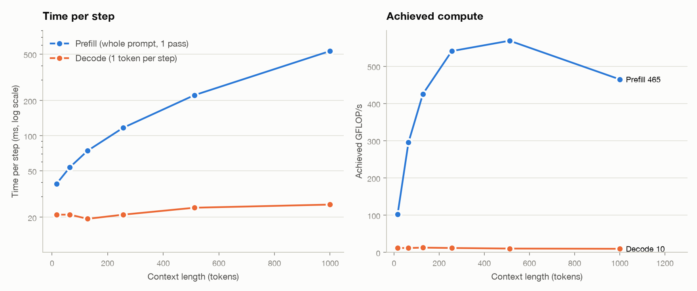
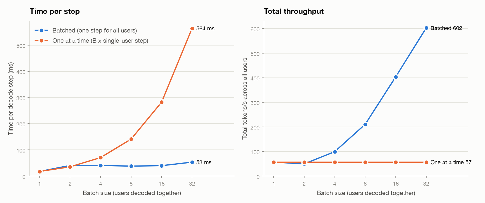

# LLM Inference from Scratch

Learn how a token gets generated, and why serving LLMs is hard, by building a tiny inference engine step by step.

**North star:** explain from first principles why LLM inference is slow and how production systems fix it.

## Curriculum

| Step | Topic | You build | You should be able to explain |
|------|-------|-----------|-------------------------------|
| 1 | Forward pass | GPT-2 in plain PyTorch, logits match HuggingFace | What happens between token ids and next-token logits |
| 2 | Naive generation | Greedy loop, recompute everything each token | Why generation is O(n^2) work without a cache |
| 3 | KV cache | Prefill + decode split with a cache | What K and V store, why decode is cheap per token |
| 4 | Sampling | Temperature, top-k, top-p | What each knob does to the distribution |
| 5 | Benchmarks | tokens/s, TTFT, KV memory vs seq length | Why decode is memory-bound, KV memory formula |
| 5b | Modernize | RoPE, RMSNorm, SwiGLU, GQA on a small Llama-style model | What modern models changed and why |
| 5c | Batching | Measure ms/step and total tokens/s for batch sizes 1..32 | Why batching gives near-free throughput in decode, and where it stops |
| 6 | Blog post | Write-up with charts | The whole story, end to end |
| 7 | Live demo | WebGPU page for sanjaybudhala.com | Same ideas, interactive |

Next-post teasers: continuous batching, paged attention, speculative decoding.

## Progress

- [x] Step 1: Forward pass
- [x] Step 2: Naive generation
- [x] Step 3: KV cache
- [x] Step 4: Sampling
- [x] Step 5: Benchmarks
- [ ] Step 5b: Modernize
- [x] Step 5c: Batching experiment
- [ ] Step 6: Blog post
- [ ] Step 7: Live demo

## Results

GPT-2 small (124M params, fp32) on an Apple-silicon MacBook Pro CPU.

| What we measured | Result |
|------------------|--------|
| KV cache speedup | 1.3x at 16 tokens, 6.6x at 512 tokens. Cached stays ~50 tok/s; naive falls from 30 to 7.6 tok/s |
| Per-token latency | Naive grows from ~30 to ~240 ms as the sequence grows; cached stays ~20 ms |
| Prefill vs decode | At 256 tokens: prefill ~590 GFLOP/s vs decode ~13 GFLOP/s. Decode is memory-bound |
| Decode time | ~17.6 ms/token, close to weights (494 MB) / ~28 GB/s effective bandwidth (an estimate) |
| KV cache size | 72 KB per token (fp32) |
| Batching | Step time flat at ~40 ms from batch 2 to 16; 603 tok/s at batch 32 vs 57 at batch 1 (10.6x), while per-user speed falls from 57 to 19 tok/s |






Each step folder has a `NOTES.md` explaining the idea and what to look for.

## Setup

```bash
python3 -m venv .venv
source .venv/bin/activate
pip install -r requirements.txt
python kv_cache/step1_forward_pass/test_matches_hf.py
```
